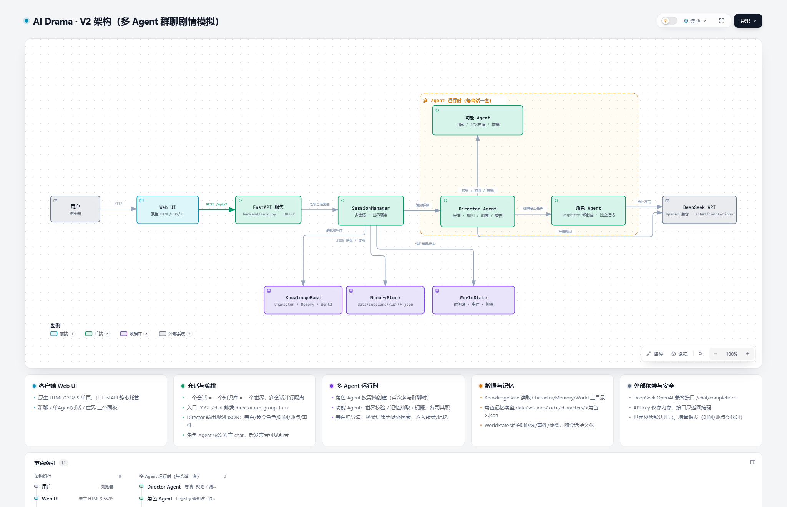

# AI Drama · 架构说明（V2）

> 版本：**V2**（正式产品化）+ 已合入 **V3 迭代 1–2** 的稳定性修复
> 架构图由 **Archify** 生成，源文件 `开发文档/assets/ai-drama-v2-architecture.html`（可交互），
> 类型化 IR：`.archify/architecture-aidrama-v2-<时间戳>/candidate.json`（本地产物，不入库）。

本文档是系统的**架构总览**，与《初版实现方案.md》《V2开发文档.md》《群聊多Agent化方案.md》互补：
前者讲"怎么实现"，本文讲"系统由什么组成、数据怎么流动、边界在哪里"。

---

## 一、概述

AI Drama 是一个基于 **DeepSeek（OpenAI 兼容接口）** 的**多 Agent 群聊剧情模拟系统**：导演 Agent 编排剧情、
多个角色 Agent 人设约束下依次发言（含旁白），世界状态、时间线、记忆随会话持久化，并提供完整 Web UI。

| 维度 | 选型 |
|---|---|
| 后端 | Python 3.10+ · FastAPI · uvicorn · httpx（直连 LLM，无框架编排） |
| 前端 | 原生 HTML / CSS / JS（无构建工具），由 FastAPI 静态托管 |
| LLM | DeepSeek `deepseek-chat`（OpenAI 兼容 `/chat/completions`） |
| 存储 | 无数据库；会话与记忆为本地 JSON 落盘（`data/`） |
| 部署 | 前后端同机，默认 `http://127.0.0.1:8008` |

---

## 二、架构图



> 交互版（可缩放 / 聚焦节点 / 追踪上下游 / 浅深色切换 / 导出）：
> **[打开 ai-drama-v2-architecture.html](assets/ai-drama-v2-architecture.html)**
>
> 交互快捷键：`?` 图例 · `/` 查找聚焦 · `R` 路径 · `M` 全览雷达 · `F` 演示 · `S` 样式 · `T` 主题 · `E` 导出。
>
> 重新生成（需本机 Archify CLI）：
> ```bash
> node <archify>/archify/bin/archify.mjs finalize architecture \
>   .archify/architecture-aidrama-v2-<ts>/candidate.json \
>   .archify/architecture-aidrama-v2-<ts>/ai-drama-v2.architecture.html \
>   --quality showcase --json
> ```

---

## 三、分层与组件

| 组件 | 类型 | 职责 | 关键文件 |
|---|---|---|---|
| **用户 / 浏览器** | external | 访问 Web UI | — |
| **Web UI** | frontend | 群聊 / 单Agent对话 / 世界 三面板；会话列表、配置、记忆编辑 | `frontend/index.html`、`app.js`、`style.css` |
| **FastAPI 服务** | backend | 全部 REST 路由 + 静态托管 | `backend/main.py` |
| **SessionManager** | backend | 多会话并行、世界隔离、活跃会话路由、创建/切换/删除/清空 | `backend/session.py` |
| **Director Agent（导演）** | backend | 群聊编排：规划 JSON（旁白/参会者/时间/地点/事件）+ 调度角色 + 生成旁白 | `backend/director.py`、`backend/prompts.py` |
| **角色 Agent** | backend | 独立实例（资料/系统提示/情感/关系/长期记忆），按需懒创建 | `backend/agents.py`、`registry.py`、`runtime.py` |
| **功能 Agent** | backend | 世界校验（World）/ 记忆抽取（Memory）/ 梗概（Synopsis），各持独立 System Prompt | `backend/runtime.py`、`director.py` |
| **DeepSeek API** | external | 规划、发言、校验、抽取、梗概的 LLM 调用 | `backend/llm_client.py` |
| **KnowledgeBase** | database | 读取 `Character/`（角色档案）、`Memory/`（初始长期记忆）、`World/`（世界观背景 + 检索） | `backend/knowledge_base.py` |
| **MemoryStore** | database | 会话/转录/角色记忆落盘：`data/sessions/<id>/*.json` | `backend/memory.py` |
| **WorldState** | database | 时间线 / 事件流 / 剧情梗概 / 时间格式 | `backend/world.py` |

**边界**：`多 Agent 运行时（每会话一套）` = 导演 + 角色 Agent + 功能 Agent；它们与数据层、会话一一对应，
不同会话之间完全隔离（一个知识库 = 一个世界 = 一套独立 Agent 集合）。

---

## 四、群聊一轮的数据流

```
用户输入
  → Web UI → POST /api/sessions/{sid}/chat
  → SessionManager 路由到活跃会话
  → Director 规划：LLM chat_json  → {narration, participants, location, date, time_of_day, event}
  → World Agent 校验：世界状态变化时增量触发
        · advisory：仅记录 issues（场外隔离，不入转录/记忆）
        · enforce ：issues 回灌导演重规划（最多 world_check_retries 次）
  → 提交世界状态与时间线（WorldState.add_event）
  → 参与者 Agent 懒创建 / 过滤（仅 role=="character" 参与）
  → 记录「用户输入」+「导演旁白」到转录
  → 各角色依次发言：LLM chat（可见前序发言，第一人称对白）
  → Memory Manager 抽取长期记忆 → 各角色记忆落盘
  → Synopsis Agent 节流更新剧情梗概
  → 全部落盘 → 返回 replies / memories_extracted / world 快照
```

**单 Agent 对话（场外）**：`POST /chat/agent` 与任意 Agent 1v1，**不进群聊转录、不抽取记忆、不更新梗概**
（记录在 `side_chats`）。

---

## 五、多会话隔离与持久化

```
data/
├── config.json                         # 模型/Key/世界校验模式/时间格式（Key 仅本地）
└── sessions/<会话ID>/
    ├── session.json                    # 会话元信息 + 世界状态 + 时间线 + 事件 + 梗概 + side_chats
    ├── transcript.json                 # 群聊完整记录（短期记忆来源，取最近 N 条）
    └── characters/<角色>.json          # 角色专属：资料快照 + 情感 + 关系 + 长期记忆（上限 80 条）
```

- **一个知识库 = 一个世界 = 一套独立 Agent 集合**：System Prompt、检索索引、对话历史、记忆文件互不混用。
- 切换会话只切视图，**不销毁数据**；重启服务从磁盘恢复。
- **唯一删除记忆的途径**：UI 中显式删除整个会话（二次确认）。

---

## 六、代码结构

```
AI-Drama-Public/
├── backend/
│   ├── main.py           # FastAPI 应用 + 全部路由 + 静态托管
│   ├── config.py         # 配置（API Key 安全加载 / 世界校验模式 / 时间格式）
│   ├── llm_client.py     # DeepSeek 调用（chat / json 模式 / 重试 / 降级）
│   ├── knowledge_base.py # 知识库扫描（三目录）→ 分类 → 检索
│   ├── prompts.py        # 全部 Prompt 模板（角色/导演/世界/记忆/梗概）
│   ├── agents.py / registry.py / runtime.py   # V2 Registry + V3 生命周期 + 功能 Agent
│   ├── world.py          # WorldState：时间线 / 事件 / 梗概 / 时间格式
│   ├── director.py       # 导演编排 + 世界校验闭环 + 记忆抽取 + 梗概
│   ├── memory.py         # 记忆持久化（MemoryStore）
│   └── session.py        # WorldSession + SessionManager（多会话）
├── frontend/             # index.html / app.js / style.css（群聊 UI）
├── data/                 # 运行时生成（gitignore）
└── requirements.txt / README.md
```

---

## 七、关键设计决策

1. **每角色独立 Agent 实例**（Registry），而非"一个通用 Agent 切 Prompt"。
2. **导演 + 功能 Agent 分离**：导演只做编排/旁白；世界校验、记忆抽取、梗概各自成为可查看/可编辑的功能 Agent。
3. **场外因素隔离**：校验 JSON、记忆指令、调度备忘绝不写入共享转录与角色记忆。
4. **角色懒创建**：会话启动只建功能 Agent，角色在首次参与群聊时按需实例化。
5. **世界校验增量触发**：仅当时间/地点/时段变化时才调用，省 token；模式 `off / advisory / enforce` 可选。
6. **导演提示词单一来源**：群聊直接使用导演 Agent 的 `system_prompt`（与详情/记忆界面一致），不再每轮临时拼装。
7. **通用命名**：角色以文档文件名为规范名，标题降级为别名，接口一律 `?name=` 传参（任意字符安全）。

---

## 八、版本演进与当前状态

| 阶段 | 内容 |
|---|---|
| V1 | 动态角色 Agent（选择器 → 检索 → Prompt → 回复） |
| V2 | Agent Registry（独立资料/记忆/状态/关系/情感）+ Character Factory |
| V3 | Runtime Manager（create/destroy/pause/resume 生命周期） |
| V4 | 世界模拟（Director + World + Timeline/Event + Memory Manager + Synopsis） |
| V2 迭代 1–9 | 启动/端口、问题修复、详情/会话管理、Key 与配置、梗概与时间格式、记忆编辑、命名通用化、GitHub 发布、导演 Agent 化、角色/Agent 分离、面板透明、懒创建、群聊多 Agent 协同 |
| **V3 迭代 1–2（本次）** | ① 修复功能 Agent 提示词重启被角色 prompt 覆盖；② 导演提示词单源化；③ 会话角色计数只统计角色 Agent；④ 清空对话一并重置梗概；⑤ API 文档同步；⑥ **世界校验自动修正闭环**（`world_check_mode: off/advisory/enforce`） |

> API 细节见《API接口参考.md》；多 Agent 设计见《群聊多Agent化方案.md》。

---

## 九、安全约定

1. **API Key** 仅存内存与本地 `data/config.json`；接口、日志、前端一律只出现掩码（如 `sk-****…****`）。
2. **场外隔离**：校验/调度/记忆抽取等场外内容不污染转录与角色记忆。
3. **世界隔离**：不同会话 = 不同知识库 = 不同 Agent 集合与记忆文件。
4. `data/`、`start/stop` 脚本、`.archify/`、`.ai-memory/` 均在 `.gitignore` 中，不随仓库发布。
